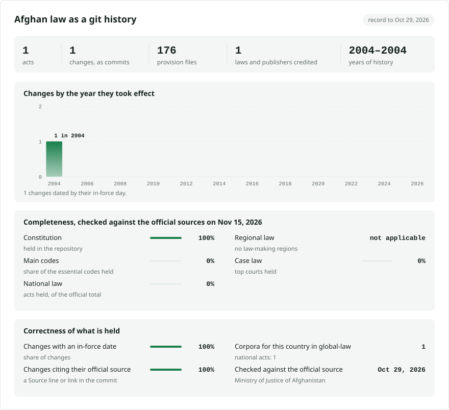

# افغانستان: تاریخچۀ قوانین در گیت

<picture>
<source media="(prefers-color-scheme: dark)" srcset="data/effort-dark.svg">

</picture>

[English](README.md)

قوانین افغانستان به شکل یک تاریخچۀ گیت: برای هر ماده یک فایل، برای هر نسخه یک کامیت به تاریخ انفاذ آن، و سندی که آن را وضع کرده به حیث نویسندۀ کامیت. `git blame` سند تقنینی هر ماده را نشان می‌دهد و `git log` هر تغییر آن را.

بخشی از [lexifina/global-law](https://github.com/lexifina/global-law): یک تاریخچۀ گیت برای قوانین همۀ کشورها.

**آنچه اکنون در آن است:** 5 سند تقنینی از جریدۀ رسمی به زبان دری، برای هر ماده یک فایل (1,444 ماده)، با تاریخ انفاذ از 2006-01-05 تا 2018-02-14: قوانین و کودها (4)، مقررات (1). متن انگلیسی قانون اساسی ۱۳۸۲ که وزارت عدلیه نشر کرده، در [`translations/en/`](translations/en/) است. ساختار و قواعد تاریخ‌گذاری در [`STRUCTURE.md`](STRUCTURE.md) و روش ساخت در [`REPRODUCE.md`](REPRODUCE.md) آمده است.

هر سند یک پوشه است و هر ماده یک فایل: `قوانین/1393/1132-قانون-اجراآت-جزائی/ماده-001.md` مادۀ اول قانون اجراآت جزائی است که در جریدۀ رسمی شماره ۱۱۳۲ سال ۱۳۹۳ نشر شده. پوشه‌ها به دری و به ترتیب نوع سند (`قوانین/`، `مقررات/`، `فرامین/`، ...)، سال هجری شمسی و شمارۀ جریده نام‌گذاری شده‌اند.

متن به زبان دری است، چنانکه جریدۀ رسمی آن را چاپ کرده؛ متن پښتو هنوز در این مخزن نیست.

## پرسش‌ها به شکل فرمان‌های گیت

| پرسش | فرمان |
| --- | --- |
| هر تغییر مادۀ اول قانون اجراآت جزائی | `git log -p --word-diff -- قوانین/1393/1132-قانون-اجراآت-جزائی/ماده-001.md` |
| کدام سند هر سطر آن را نوشته؟ | `git blame قوانین/1393/1132-قانون-اجراآت-جزائی/ماده-001.md` |
| همۀ اسناد با تاریخ انفاذ هر یک | `git log --format="%h %(trailers:key=In-force,valueonly,separator=) %an"` |

## تاریخ‌ها

هر کامیت به ساعت ۱۲ ظهر به وقت کابل در روز انفاذ آن سند تاریخ‌گذاری شده و همان روز در `In-force:` آمده است. تاریخ انفاذ از مادۀ انفاذ خود سند گرفته می‌شود: از تاریخ نشر در جریدۀ رسمی، یا مدتی پس از آن. سندی که از تاریخ توشیح یا منظوری نافذ می‌شود، به تاریخ نشر جریده ثبت شده است، زیرا دست‌کم از آن روز نافذ بوده. سندی که مادۀ انفاذ آن خوانده نشود، نگه داشته شده و حدس زده نمی‌شود. هیچ تاریخی در این مخزن روز دانلود ما نیست.

`Authority:` دولتی را نام می‌برد که سند را نشر کرده است؛ از ۲۴ اسد ۱۴۰۰ (۱۵ اگست ۲۰۲۱) مقامات بالفعل، به نامی که جریده به کار می‌برد. این تنها ثبت ناشر است، نه نظری دربارۀ اعتبار سند.

## آنچه نشان نمی‌دهد

- **تعدیلات تلفیق نشده‌اند.** هر سند چنانکه در جریده نشر شده ثبت شده؛ سند تعدیلی پوشۀ جداگانه دارد.
- **جریده‌های بدون لایۀ متنی قابل استفاده.** جریده‌های پیش از ۱۳۸۱ تصویر اسکن‌شده‌اند؛ چیزی OCR نشده و این‌ها نگه داشته شده‌اند (119 مورد تا کنون). جریده‌هایی که با فونت قدیمی Pashto Aryob چاپ شده‌اند، از جمله کود جزا (جریدۀ ۱۲۶۰)، از روی کدهای خود فونت به متن یونیکد برگردانده شده‌اند (Text-source: legacy-font conversion).
- **چگونگی تطبیق قانون.** این مخزن متن نشرشده را نگه می‌دارد، نه اینکه در عمل چگونه تطبیق می‌شود.

## منابع

| منبع | نوع | یادداشت |
| --- | --- | --- |
| [دیتابیس قوانین وزارت عدلیه](http://laws.moj.gov.af/ShowLawPersian.aspx) | رسمی: جریدۀ رسمی به شکل PDF | متن دری از لایۀ متنی خود PDF |
| [وزارت عدلیه: قانون اساسی نافذ (انگلیسی)](https://moj.gov.af/en/enforced-constitution-afghanistan) | رسمی | یک متن، بدون تاریخچۀ تعدیل |

## جواز

[`LICENSE`](LICENSE) را ببینید. متون، نشرات رسمی وزارت عدلیۀ افغانستان‌اند و با ذکر منبع نقل شده‌اند. ترتیب، جدول‌ها، پیام‌های کامیت و ابزارهای Lexifina تحت CC0 1.0 به مالکیت عمومی سپرده شده‌اند.

هیچ مدل هوش مصنوعی متن قانونی را ننوشته، ترجمه یا اصلاح نکرده است.
