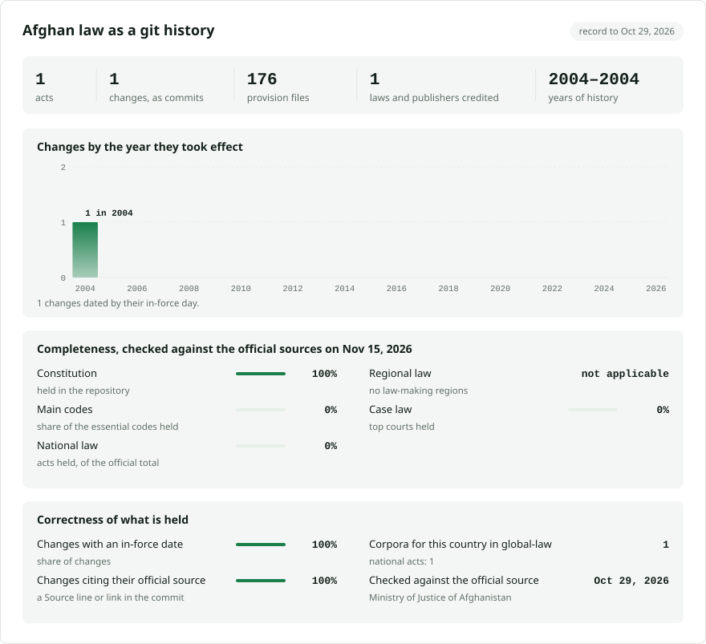

# Afghanistan: law history in git

<picture>
<source media="(prefers-color-scheme: dark)" srcset="data/effort-dark.svg">

</picture>

The law of Afghanistan as a git history: one file per provision, one commit per version on the day it took effect, and the act that made each change as the commit's author. `git blame` names the act behind every article; `git log` lists every change to an article; picking a date gives the text in force that day.

Part of [lexifina/global-law](https://github.com/lexifina/global-law), one git history for every country's law: this is Afghanistan's national law, which global-law reads at `afghanistan/national/acts/`.

**What is in it now:** 194 instruments from the Official Gazette in Dari, one file per article (7,400 articles), in force from 2006-01-05 to 2019-03-23: laws and codes (117), regulations (50), statutes of public bodies (7), decrees (7), other instruments (7), treaties and agreements (5), resolutions (1). The Ministry of Justice's English text of the 2004 Constitution is under [`translations/en/`](translations/en/). [`STRUCTURE.md`](STRUCTURE.md) gives the layout and the dating rules; [`REPRODUCE.md`](REPRODUCE.md) says how the files were made.

Each act is a folder with one file per article: `قوانین/1393/1132-قانون-اجراآت-جزائی/ماده-001.md` is Article 1 of the Criminal Procedure Code, published in Official Gazette No. 1132 of 1393 (2014). Folders are named in Dari, by type (`قوانین/` laws, `مقررات/` regulations, `فرامین/` decrees, ...), solar-hijri year and gazette number.

The text is in Dari, as the Official Gazette prints it; the gazette also prints each instrument in Pashto, the other official language, which is not part of this record yet. The English Constitution is the ministry's translation, kept under `translations/en/`.

## Questions as git commands

| Question | Command |
| --- | --- |
| Every change to Article 1 of the Criminal Procedure Code | `git log -p --word-diff -- قوانین/1393/1132-قانون-اجراآت-جزائی/ماده-001.md` |
| Which instrument wrote each line of it? | `git blame قوانین/1393/1132-قانون-اجراآت-جزائی/ماده-001.md` |
| Every instrument, with the day each took effect | `git log --format="%h %(trailers:key=In-force,valueonly,separator=) %an"` |
| The English Constitution, Article 1 | `cat translations/en/constitution/art-001.md` |

**Outside git**, we also host this record publicly, for free:

- **[Ask Claude about Afghan law](https://global-law.lexifina.com/v1/try_claude?country=afghanistan)**: opens Claude with a first question ready.
- **[Ask ChatGPT](https://global-law.lexifina.com/v1/try_chatgpt?country=afghanistan)**: the same question in ChatGPT.
- **[Search Afghan law on our site](https://lexifina.com/law?country=afghanistan&q=freedom+of+expression)**: a search for "freedom of expression", with each provision's text and its versions, no account needed.
- **[Developer REST API](https://global-law.lexifina.com/v1/search_law?query=freedom+of+expression&jurisdiction=afghanistan)**: the same search as JSON, with no key. See the [documentation here](https://lexifina.com/api/global-law).

Both assistants read the record through the free Global law connector (MCP, `https://global-law.lexifina.com/mcp`); the first time, the chat gives you the link that adds it. Ask in English or Dari.

**Host it yourself easily.** All it takes is git and Python, and the tools run on your machine:

```sh
git clone --depth 1 https://github.com/lexifina/global-law && cd global-law
python3 tools/countries.py add afghanistan/national/acts
python3 tools/law.py show 2026-01-01 afghanistan/national/acts/قوانین/1393/1132-قانون-اجراآت-جزائی/ماده-001.md
```

Opened in Claude Code, Cursor, VS Code or Codex, the clone also starts a local MCP server with the same tools ([MCP.md](https://github.com/lexifina/global-law/blob/main/MCP.md)).

## Dates

Each commit is dated at noon, Asia/Kabul, on the day the version took effect, and carries it in its `In-force:` trailer:

- a gazette instrument is dated by its own commencement article: from publication in the gazette, or a stated time after it, counted from the gazette's date (`In-force-basis:` quotes the article); one that takes effect on signing or approval is dated the day the gazette published it, by which it was in force at the latest; one whose commencement the builder cannot read is held;
- the English Constitution keeps its one version, 3 January 2004, the day of the Loya Jirga's approval as the preamble gives it.

Each gazette commit is credited to the instrument it publishes, as the ministry's database titles it, with an `Authority:` trailer naming the state that published it (from 15 August 2021, the de facto authorities as the gazette names them). The English Constitution is credited to the ministry as the "oldest version available" (`Kind: publisher`); the committer is Lexifina.

## How it is checked

- `tools/check_repo.py` reads every version back from git on the day it took effect and on the day before and compares it with the corpus, whose hash is in `data/corpus.sha256`; it also checks that every commit's trailers parse, that `main` has no merge commits and that no commit is dated in the future. It covers the English Constitution; the gazette instruments are appended by the runner REPRODUCE.md describes, which keeps the hash of every act's files.
- `tools/build.py` writes the history from that one corpus file, and the same corpus gives the same commit hashes. [`REPRODUCE.md`](REPRODUCE.md) records that the checks were not yet run for this build and that no second build has been compared.
- The sha256 of the page bytes the text was parsed from is in `data/versions.json`. Quotes and dashes are normalised; the wording is the page's own, typos included.
- [vulnerabilities/](vulnerabilities/): possible drafting mistakes in this law, found by global-law's detectors and checked by hand. Not run yet.

## What it does not show

- **Amendments.** Each instrument is recorded as the gazette published it; an amending instrument is its own folder, and the amended text is not consolidated.
- **Gazettes without a usable text layer.** Gazettes before 2002 are image scans; nothing is OCRed, so these are held, as are instruments whose articles or commencement the builder cannot read (651 items so far). Gazettes set in the legacy font Pashto Aryob, among them the Penal Code of 2017, are converted from the embedded font's own codes (Text-source: legacy-font conversion; STRUCTURE.md).
- **Earlier constitutions**, which are not versions of the 2004 text.
- **How the text is applied.** The record holds what the ministry publishes as the enforced text, not whether or how it is applied in practice.

## Sources

| Source | Kind | Past versions | Notes |
| --- | --- | --- | --- |
| [Ministry of Justice: law database](http://laws.moj.gov.af/ShowLawPersian.aspx) | Official: the Official Gazette (جریدۀ رسمی) as PDFs, with a list of every instrument | as enacted, each instrument in its gazette | Dari text from the PDFs' own text layer; read from 27 November 2026 |
| [Ministry of Justice of Afghanistan](https://moj.gov.af/en/enforced-constitution-afghanistan) | Official publication: "Enforced Constitution of Afghanistan" (English) | no, one text | Read on 29 October 2026; the page states no amendment history |

## Licence

See [`LICENSE`](LICENSE). The texts are official publications of the Ministry of Justice of Afghanistan (the Official Gazette and its English Constitution), reproduced with attribution. Lexifina's arrangement, tables, commit messages and tools are dedicated to the public domain under CC0 1.0.

No AI model wrote, translated or corrected legal text; the scripts were written by an AI model (see [`REPRODUCE.md`](REPRODUCE.md)).

## Visualisations

- [visualisations/](visualisations/): charts drawn from this repository. Not drawn yet.

## More

From [lexifina/global-law](https://github.com/lexifina/global-law):

- [FEATURES.md](https://github.com/lexifina/global-law/blob/main/FEATURES.md): every feature, and what every corpus must support (`git blame`, `law.py`, the MCP tools)
- [FAQ.md](https://github.com/lexifina/global-law/blob/main/FAQ.md): questions and answers · [CONTRIBUTING.md](https://github.com/lexifina/global-law/blob/main/CONTRIBUTING.md): proposing changes · [MCP.md](https://github.com/lexifina/global-law/blob/main/MCP.md): the MCP server · [REPRODUCE.md](https://github.com/lexifina/global-law/blob/main/REPRODUCE.md): how it was built · [CHANGELOG.md](https://github.com/lexifina/global-law/blob/main/CHANGELOG.md)
- [FRESHNESS.md](https://github.com/lexifina/global-law/blob/main/FRESHNESS.md): how current each corpus is · [Monitoring](https://github.com/lexifina/global-law/tree/main/monitoring): whether updates are running · [WATCHING.md](https://github.com/lexifina/global-law/blob/main/WATCHING.md): how each official source is watched for changes
- [performance/](https://github.com/lexifina/global-law/tree/main/performance): how fast the tools are, measured
- [visualisations/](https://github.com/lexifina/global-law/tree/main/visualisations): charts and bridges across the world's law
- [Vulnerabilities](https://github.com/lexifina/global-law/tree/main/vulnerabilities): mistakes in legislation as published
